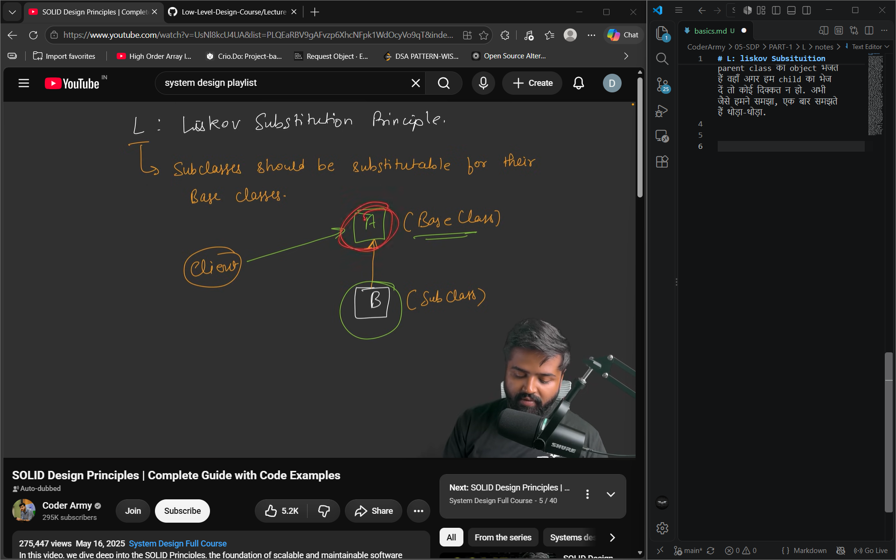
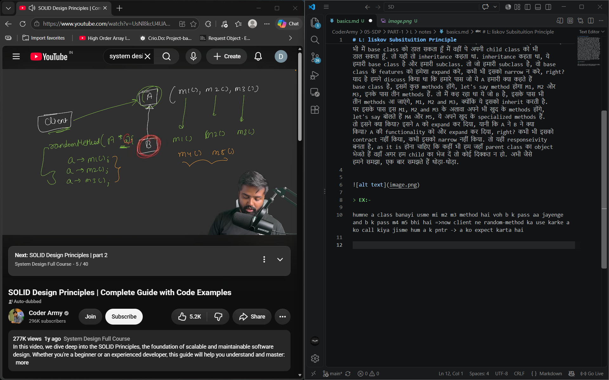
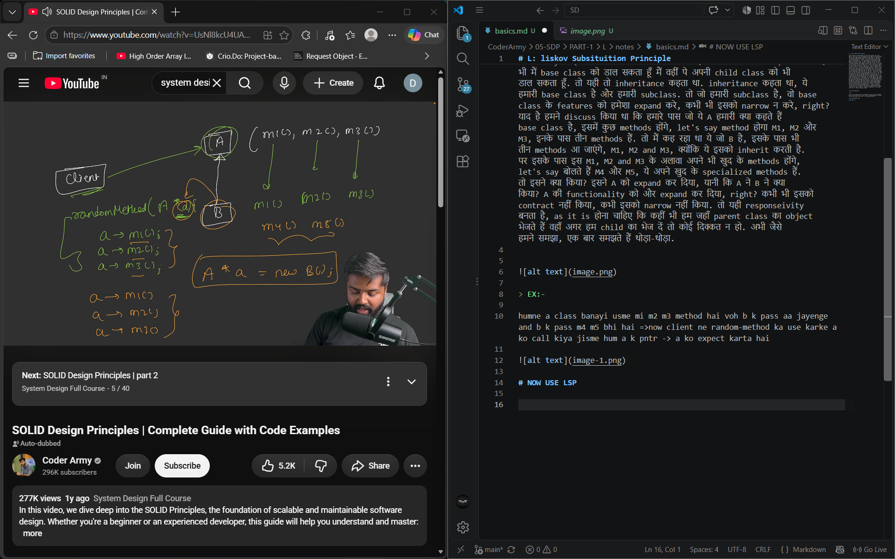
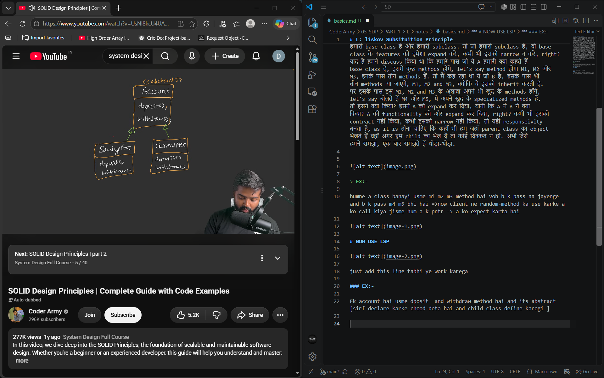
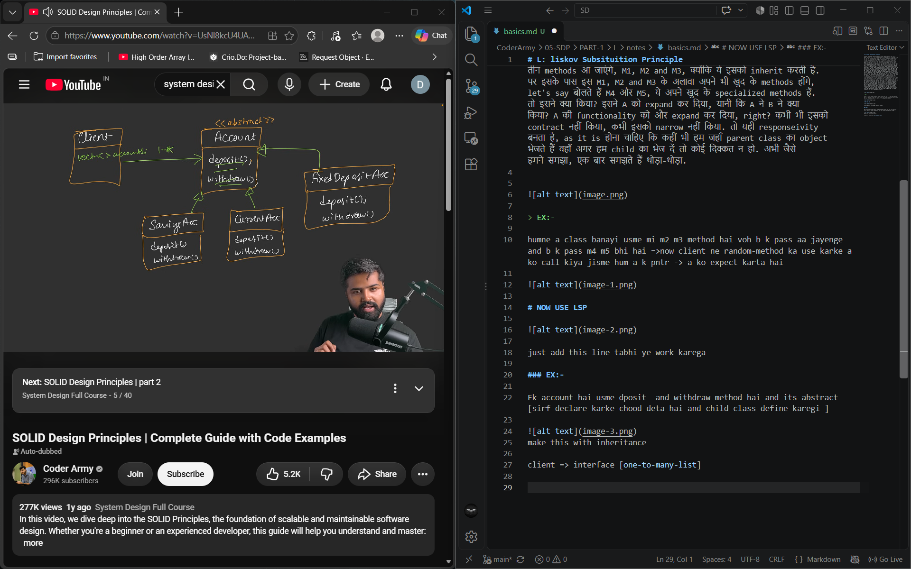
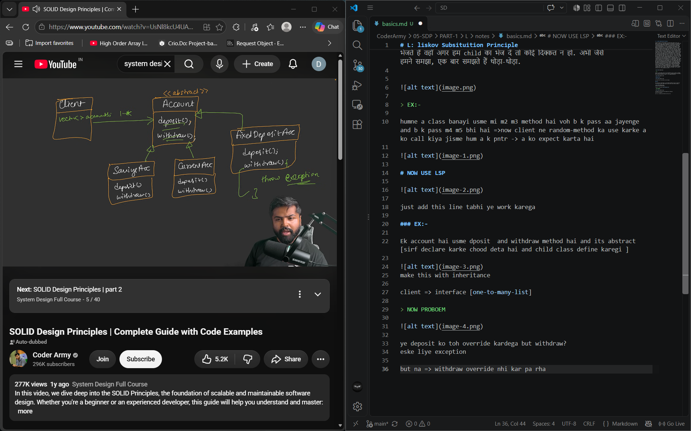
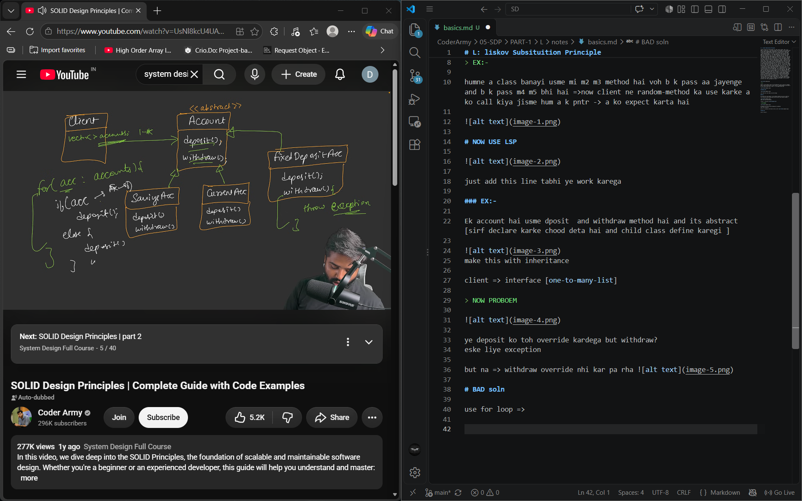
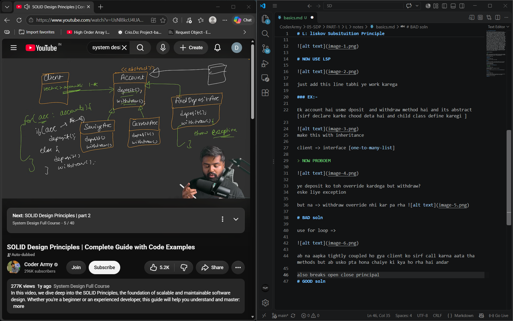
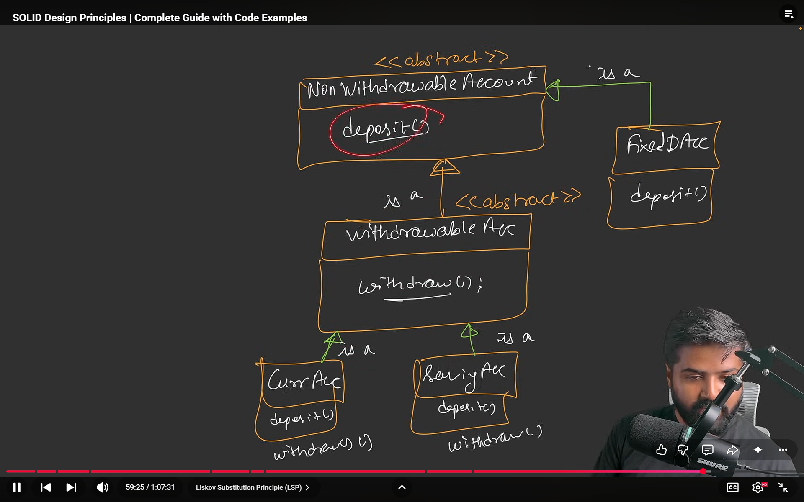

# L: liskov Subsituition Principle

Classes should be substitutable for their base classes. क्या मतलब? देखो, ये line अभी जब मैं आपको समझाऊँगा तो आपको लगेगा ये तो already हमें पता है, इसी को inheritance बोलते हैं और ये तो बहुत basic property है. पर आपको जान के हैरानी होगी ये इतनी basic property है, पर still सबसे ज़्यादा इसको break किया जाता है जब हम real-life project बनाते हैं। जानबूझ के break नहीं किया जाता है, break हो जाता है, क्योंकि हम सारे इससे जो rules हैं वो दिमाग में नहीं रखाते हैं. अभी वो क्या है, कैसे दिखता है, वो आपको समझ आएगा. एक बार समझ लेते हैं. चलो. तो मैंने कहा, subclasses should be substitutable for their base classes. अब इसका क्या मतलब? इसको समझते हैं. चलो, suppose करो आपके पास एक class है A, ठीक है, और एक class है B. तो ये जो B class है ना, ये let's say inherit करती है A class. ठीक है? तो हमारी जो A class हो गई, वो हो गई हमारी base class और हमारी जो B हो गई, वो हो गई हमारी subclass, right? या parent class और child class बोल लो. अब Liskov substitution principle ये कहता है कि कोई भी ऐसा client, कोई भी ऐसा client, जो किसी method में A class तक कर रहा हो, यानी कि ऐसा कोई method call हो जहाँ पे आपको A class, A base class का reference को pass करना हो और अगर मैं उसकी जगह B class का reference को pass कर दूँ तो भी कोई दिक्कत न हो, तब भी code न बचे, हर चीज़ बिल्कुल as it is चलनी चाहिए. इसका मतलब क्या हुआ? इसका मतलब ये हुआ कि base class basically कोई भी subclass substitutable है base class के लिए. मतलब जहाँ भी मैं base class को डाल सकता हूँ मैं वहीं पे अपनी child class को भी डाल सकता हूँ. तो यही तो inheritance कहता था. inheritance कहता था, ये हमारी base class है और हमारी subclass. तो जो हमारी subclass है, वो base class के features को हमेशा expand करे, कभी भी इसको narrow न करे, right? याद है हमने discuss किया था कि हमारे पास जो ये A हमारी क्या कहते हैं base class है, इसमें कुछ methods होंगे, let's say method होगा M1, M2 और M3, इनके पास तीन methods हैं. तो मैं कह रहा था ये जो B है, इसके पास भी तीन methods आ जाएंगे, M1, M2 and M3, क्योंकि ये इसको inherit करती है. पर इसके पास इस M1, M2 and M3 के अलावा अपने भी खुद के methods होंगे, let's say बोलते हैं M4 और M5, ये अपने खुद के specialized methods हैं. तो इसने क्या किया? इसने A को expand कर दिया, यानी कि A ने B ने क्या किया? A की functionality को और expand कर दिया, right? कभी भी इसको contract नहीं किया, कभी इसको narrow नहीं किया. तो यही responseivity बनता है, as it is होना चाहिए कि कहीं भी हम जहाँ parent class का object भेजते हैं वहाँ अगर हम child का भेज दें तो कोई दिक्कत न हो. अभी जैसे हमने समझा, एक बार समझते हैं थोड़ा-थोड़ा.

> EX:-

humne a class banayi usme mi m2 m3 method hai voh b k pass aa jayenge and b k pass m4 m5 bhi hai =>now client ne random-method ka use karke a ko call kiya jisme hum a k pntr -> a ko expect karta hai 

# NOW USE LSP

just add this line tabhi ye work karega 

### EX:-

Ek account hai usme dposit  and withdraw method hai and its abstract [sirf declare karke chood deta hai and child class define karegi ]

make this with inheritance 

client => interface [one-to-many-list]

> NOW PROBOEM

ye deposit ko toh override kardega but withdraw?
eske liye exception

but na => withdraw override nhi kar pa rha 

# BAD soln

use for loop =>

ab na aapka tightly coupled ho gya client ko sirf call karna aata tha methods but ab usko pta hona chaiye ki kya ho rha hai andar

also breaks open close principal  

# GOOD soln

Notice FixedDepositAc never should be child of Account 

Change the dia a little bit 

Clint is tigitly coupled here

