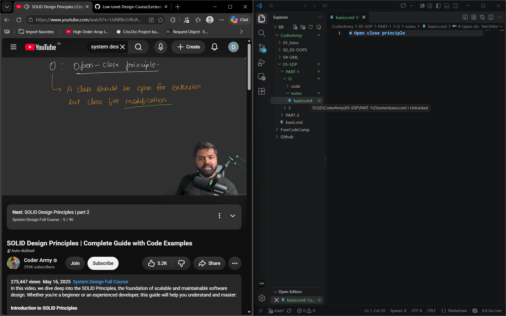
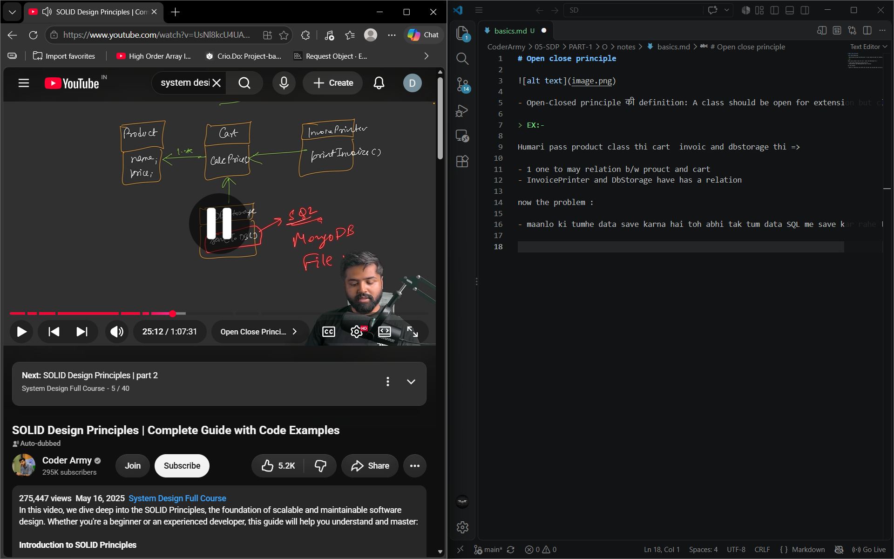
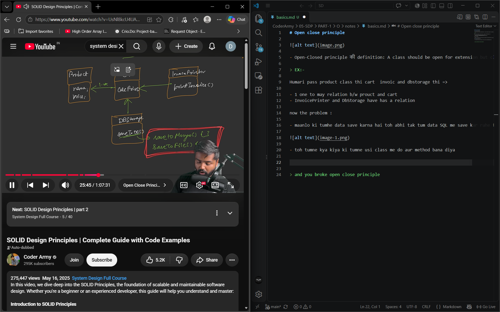
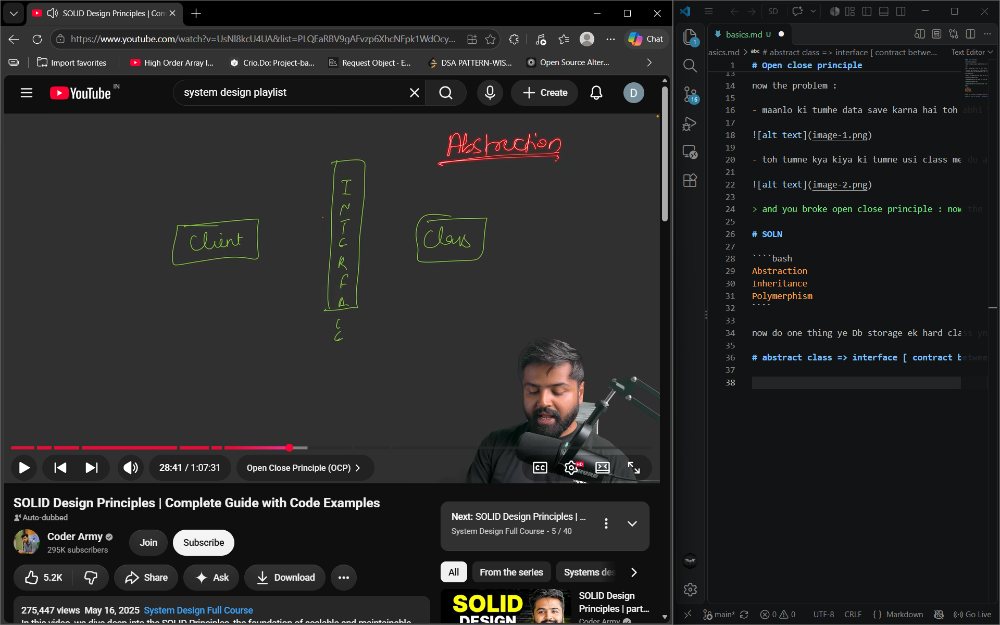
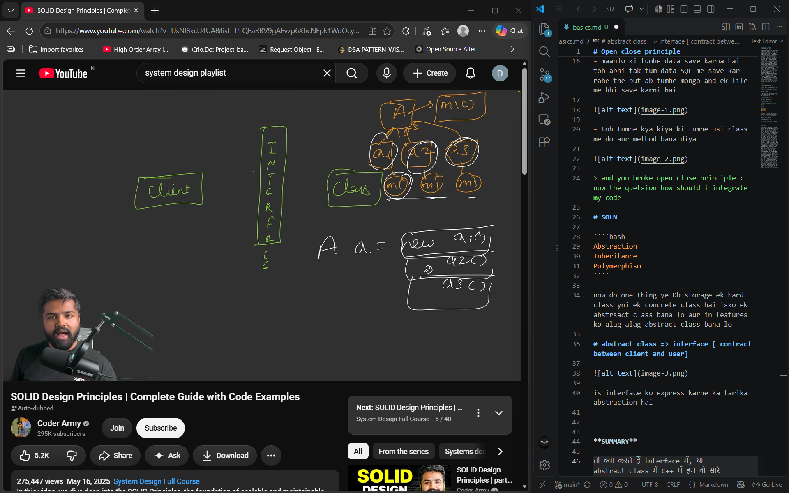
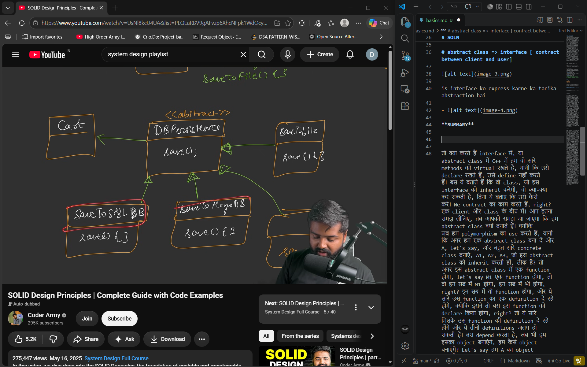

# Open close principle 



- Open-Closed principle की definition: A class should be open for extension but closed for modification. क्या मतलब है इसका? देखो modification का मतलब होता है पुराने code को change करना, बिल्कुल पुरानी class में जाकर के जो भी आपने लिखा हुआ है methods, उसको change करना. और extension का मतलब होता है नए feature को add करना. तो Open-Closed principle ये कहता है कि कोई भी नए feature को add करने के लिए हम पुरानी classes के code को change ना करें, हम पुराने code को ही touch ना करें. तो अब आप बोलेंगे ये कैसा concept है, पुराने code में तो changes करने पड़ेंगे. पर ये Open-Closed principle आपको ये बताता है कि कोई नया feature को integrate करने के लिए आप जो पुरानी already बनी हुई classes जो हैं ना, उसके methods में जाकर के कोई नया method मत लिख दो, basically class में जाकर कोई नया method मत लिख दो. ये बहुत strict rule है, बहुत high level पे, मुझे लगता है बहुत sanitary level पे या बिल्कुल idealistic level पे इसको हर जगह absolutely follow किया जाता है. कोशिश करनी चाहिए कि Open-Closed principle को आप जितना ज़्यादा follow कर पाओ, उतना better है. वो हम यहाँ last में बात करेंगे, वैसे पर पहले principle का समझते हैं. तो Open-Closed principle ये कह रहा है कि a class should be open for extension and closed for modification. ठीक है? अब कैसे? कैसे हो सकता है ये? मतलब अगर हमें एक नया feature integrate करना है और हम कह रहे हैं हम कोई already existing code को change ही ना करें, है ना? तो ये कैसे possible होगा? तो पहले हम देखते हैं problem क्या आती है, फिर हम देखेंगे possible कैसे होगा, ठीक है?

> EX:-

Humari pass product class thi cart  invoic and dbstorage thi =>

- 1 one to may relation b/w prouct and cart
- InvoicePrinter and DbStorage have has a relation 

now the problem :

- maanlo ki tumhe data save karna hai toh abhi tak tum data SQL me save kar rahe the but ab tumhe mongo and ek file me bhi save karni hai 



- toh tumne kya kiya ki tumne usi class me do aur method bana diya 



> and you broke open close principle : now the quetsion how should i integrate my code 

# SOLN

````bash
Abstraction
Inheritance
Polymerphism
````

now do one thing ye Db storage ek hard class yni ek concrete class hai isko ek abstrsact class bana lo aur in features ko alag alag abstract class bana lo 

# abstract class => interface [ contract between client and user]



is interface ko express karne ka tarika abstraction hai 

- 

**SUMMARY**

तो क्या करते हैं interface में, या abstract class में C++ में हम वो सारे methods को virtual रखते हैं, यानी कि उसे declare रखते हैं, उसे define नहीं करते हैं। बस ये बताते हैं कि वो class, जो इस interface को inherit करेगी, वो क्या-क्या कर सकती है, बिना ये बताए कि उसे कैसे करे। We contract का काम करते हैं, right? एक client और class के बीच में। आप इतना समझ लीजिए, तब आपको समझ आ जाएगा कि हम abstract class क्यों बनाते हैं। क्योंकि जब हम polymorphism का use करते हैं, यानी कि अगर हम एक abstract class बना दें और A, let's say, और बहुत सारे concrete class बनाएं, A1, A2, A3, जो इस abstract class को inherit करती हों, ठीक है? तो अगर इस abstract class में एक function होगा, let's say M1 एक function होगा, तो वो इन सब में M1 होगा, इन सब में भी होगा, right? इन सब में वो function होगा, और ये सारे उस function का एक definition दे रहे होंगे, क्योंकि इसने तो बस इस function को declare किया होगा, right? तो ये सारे मिलके उस function की definition दे रहे होंगे और ये तीनों definitions अलग हो सकती हैं। बस depend करता है, जब भी हम इसका object बनाएंगे, हम कैसे object बनाएंगे? Let's say हम A का object बनाएंगे, let's say A equal to new. अब उस new में हम कुछ भी store कर सकते हैं, A1 store कर सकते हैं, A2 store कर सकते हैं या A3 store कर सकते हैं. क्योंकि again हम child class के object को parent class के reference को assign करवा सकते हैं polymorphism के through, इसी को method overriding बोलते हैं. और एक बार हमने ये किया, तो अगर हमने new A1 किया होगा तो M1 A1 का call होगा, अगर हमने new A2 call किया होगा तो ये जो M1 method है, वो A2 के अंदर का call होगा, और same अगर A3 किया होगा तो M1 method A3 के अंदर का call होगा. ये एक थोड़ा सा overview है, शायद आप लोग समझते हैं, इसी को पूरा का पूरा inheritance और polymorphism मिलाके use करते हैं हम, इसी को हम interfaces बोलते हैं और method overriding use करता है interface. Basically interface बहुत ज़्यादा method overriding use करता है ताकि ये सारा का सारा आपको feature provide कर सके, ठीक है? तो चलो वापस चलते हैं अपने problem.


**SOLN**



देखें, हमने problem ये था। हमने क्या कहा था? हमने यही कहा था, यहाँ पे काम करते हैं। हम ये जो DB persistence class थी, इसे abstract class बना देते हैं, क्योंकि ऊपर हमारा क्या चल रहा था? ये जो हमने class बनाई थी, ये एक concrete class थी, जो कि ये सारे के सारे methods को declare कर रही थी। और हम ये तो बहुत गलत तरीका था कि हम सारे के सारे methods को define कर देंगे open-close principle पे करा रहा था। तो हमने एक abstract class बना दी, DB persistence, और हमने क्या किया, जितने भी हमारे persistence करने के तरीके हैं, जो हमारे feature है, for example ये है save to SQL DB, जो पहले से बना हुआ था, right? अब ये हमने एक अलग class बना दी। ऐसे ही एक हमारे पास अब आ गया नया feature, save to MongoDB, let's say, तो इसके हमने एक अलग class बना दी। ऐसे ही हमारे पास आ गया save to file, और इसके हमने same समय से एक अलग class बना दी। और हमने कहा, ये जो तीनों class हैं, ये इसे inherit करती हैं। inheritance हो गया, देखा? हैरो बना, inheritance से. ये तीनों class inherit करती हैं, मतलब तीनों के तीनों persistence logic को inherit करती हैं। तो अगर persistence DB persistence के function है save, जो भी से declare है, तो इन तीनों के लिए function होगा save, जिसे define करेंगे. इसने function होगा save, जिसे define करेगा save, जिसे define करेगा. और वही जैसे हमने नीचे बात की थी, save to database, SQL database में तो save function होगा, वो सारी की सारी वो block हमें clear करेगी कि हमें SQL database के अंदर चीज़ों को कैसे store करना है, save to MongoDB के अंदर save function होगा, वो सारी की सारी वो block हमें clear करेगी कि हमें MongoDB में database को कैसे store करना है. और same save to file, save function सारा clear करेगा कि हमें file में कैसे store करना है. तो let's say ये कुछ query लगाएगा, right? ये कुछ methods call करेगा MongoDB के, और save to file, file into output पे काम करेगा. पर इन सबका save अलग होगा, पर save एक ही method होगा save, method overriding के through हम इसमें ये चीज़ कर सकते हैं. अब मैंने इनकी अलग-अलग classes बना दी, अब बाकी चीज़ बिल्कुल same रहती हैं. अब हम क्या करते हैं, let's say, यहाँ पे हमारी जो card class है, वो हम यहाँ बना देते हैं, ये रही हमारी एक card class, ठीक है? और card class के पास है as a relationship card, तो हमने क्या बना लिया, यानी कि अब सब कुछ बाकी चीज़ same है, बस हमने क्या किया, हमने introduce कर दिया एक नए abstraction को, which is DB persistence. अब जो card है, वो DB persistence से बात करता है, यानी कि inverted bola, DB persistence जो है, वो जो card के method को call करता है save, वो उसको integrate करने के अलग-अलग तरीके हैं, उसको method overriding करने के अलग-अलग तरीके हैं. अब अगर आपको database में store करना है, तो एक class, अगर आपको MongoDB में store करना है, एक class है, file में store करना है तो अलग class है. तो यहाँ पे हमने Open/Closed principle solve कर दिया. कैसे? अब जब भी एक नया feature आया, जैसे MongoDB का हमने गलत class बनानी, इस class को छेड़ा नहीं. save to file का हमने गलत class बनाई, पुरानी classes को किसी को भी नहीं छेड़ा. अब practically कोई एक नया persistence आ जाता है, हमें MongoDB, SQL में पढ़ी है, एक Cassandra DB है, उस पे भी हम store करना है, हम दोबारा वही करेंगे जो भी काम करते आ रहे थे, अब तो बहुत ही, हम क्या करेंगे, एक नई class बनाएंगे और उसको inherit करवा लेंगे, इस same class. और सारा का सारा save का code यहाँ लिखते हैं. तो पुराने code में छेड़ नहीं पड़ रहा, क्यों? क्योंकि बस हमने एक level पर abstraction introduce कर दिया. और अब इस abstraction में एक ही method है save. अब जब भी आप card, जब भी save method call करेंगे, तो जो भी हमने new operator से select किया होगा.